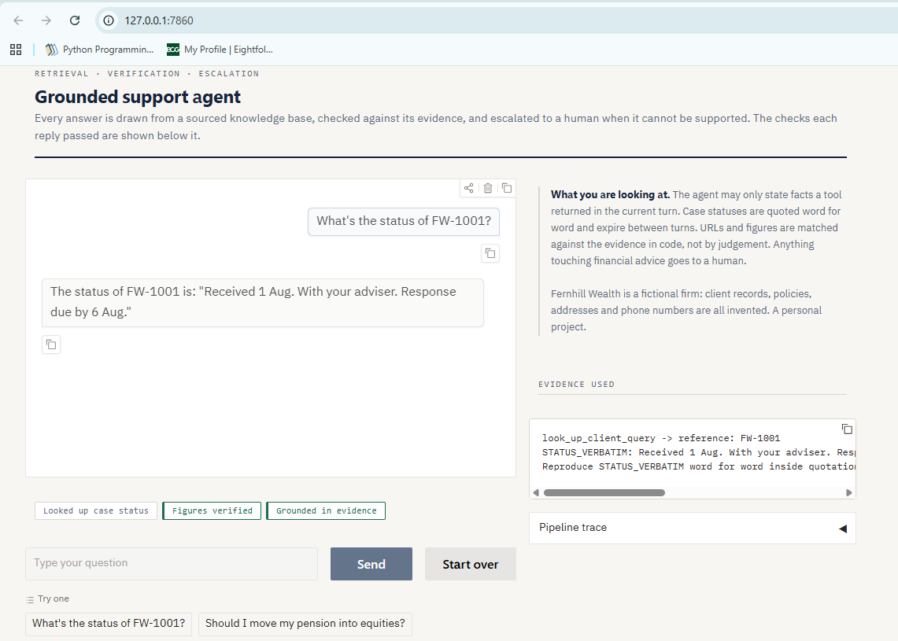
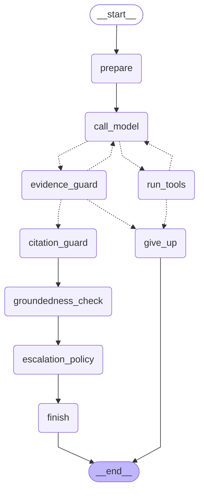

# Grounded Support Agent

[](https://github.com/jitendraSuwalka/support-bot/actions/workflows/ci.yml)



A customer support agent for Fernhill Wealth — a fictional UK wealth-management
firm — built to answer only
what it can evidence — and to prove, in code, that it does.

The interesting part is not that an LLM can call tools. It is that a support
assistant in a regulated industry must never invent a phone number, never
paraphrase a case status into something rosier, and never leave a customer
looping when it cannot help. This project treats those as engineering
requirements with tests attached, rather than as instructions in a prompt and
a hope.

```
python app.py          # web interface
python agent.py        # same agent, in the terminal
pytest                 # 225 tests, under ten seconds, no API calls, no network
```

> **Fernhill Wealth is fictional.** It is modelled on how UK wealth-management
> firms present their services, complaints procedures and client support —
> informed by my own experience working in the sector — but every policy,
> address, client record and phone number is invented. The website lives on the
> reserved `.example` domain and the phone numbers come from Ofcom's film-and-
> drama ranges, so the agent can never direct a real customer to a real place.
> The eighteen documents it answers from were reviewed against primary sources
> (gov.uk, FSCS, the Financial Ombudsman) on 20 October 2026; `corpus/README.md`
> lists every public figure with its source. A personal learning project; no
> real client data is used anywhere.

---

## Contents

- [Why this project](#why-this-project)
- [Architecture](#architecture)
- [Failure modes found in testing](#failure-modes-found-in-testing)
- [Testing strategy](#testing-strategy)
- [Design decisions and trade-offs](#design-decisions-and-trade-offs)
- [Known limitations](#known-limitations)
- [Running it](#running-it)

---

## Why this project

Retrieval-augmented chatbots are easy to demo and hard to trust. A demo answers
a question fluently; a trustworthy system knows what it does not know, refuses
to embellish, and fails loudly rather than plausibly.

Financial services makes those distinctions concrete. Quoting a case status
inaccurately is a customer-relations problem. Answering "should I move my
pension into equities?" is a regulatory one. So the design question driving
this build was:

> Which guarantees can live in a prompt, and which must live in code?

The answer, repeatedly, was **code**. Every hard guarantee here is enforced in
Python, because a system prompt is a strong suggestion and nothing more —
something demonstrated below by a model that broke a rule marked MUST, and was
right to.

---

## Architecture

Three tools, and a loop that runs while the model asks for them — written twice,
as a plain loop and as a LangGraph state graph that share every step and are
tested as one (see [The agent as a graph](#the-agent-as-a-graph)).

| Tool | Purpose |
|---|---|
| `search_knowledge_base` | the firm's documents in `corpus/` — 18 pages, hybrid BM25 + vector search |
| `look_up_client_query` | Case status by reference (synthetic data) |
| `escalate_to_adviser` | Hand-off to a human, mandatory for advice topics |

### Request lifecycle

```
user question
     │
     ├─ expire volatile results from previous turns      (staleness)
     │
     ├─ generation with tools available                   (the model decides what to look up)
     │
     ├─ RETRIEVAL — hybrid, over 18 documents in 129 chunks
     │    ├─ LLM query expansion                          (widens the lexical side only)
     │    ├─ BM25 over chunks, normalised to the query ceiling   (exact strings: numbers, references)
     │    ├─ dense search: local ONNX embeddings, Qdrant  (meaning: "pay into" finds "allowance")
     │    ├─ reciprocal rank fusion                        (agreement outranks either favourite)
     │    ├─ relevance floors: lexical 0.15 or cosine 0.60 (the cosine floor is measured, not guessed)
     │    └─ LLM rerank of the top 6                       (reading beats counting)
     │
     ├─ answer, constrained by STATUS_VERBATIM fields
     │
     ├─ CHECK 0: evidence guard — deterministic           (no answering from memory)
     ├─ CHECK 1: citation guard — deterministic           (URLs and numbers)
     ├─ CHECK 2: groundedness — independent LLM           (semantic drift)
     ├─ CHECK 3: escalation policy — deterministic        (clarify once, then escalate)
     │
     └─ answer + audit trail of raw evidence
```

Checks run cheapest-and-most-certain first. The deterministic citation guard
runs before the LLM fact-checker, because a `re.findall` costs nothing and
cannot be argued with.

### Hybrid retrieval, then reranking

The firm's documents live in `corpus/` as Markdown with front matter (title,
URL, version, review date, owner). `rag/corpus.py` splits each along its
headings into chunks that carry their title, section and page URL, so every
answer can be traced to the page it came from. Chunk ids are content hashes:
edit one sentence and one chunk is re-embedded, not the corpus.

Two searches run on every question and their rankings are merged by
**reciprocal rank fusion** (score = Σ 1/(60 + rank)). Each is good at what
the other is bad at, and the live run showed it in one line: asked *"Whose
number is 0161 496 0170?"*, the vector index on its own ranked the Manchester
office **fifth** — a phone number means nothing to a meaning model — while
BM25 ranked it first, and fusion put it first overall. Asked *"How much can I
pay into an ISA this tax year?"*, both methods ranked the ISA allowance first.

Embeddings come from `BAAI/bge-small-en-v1.5` run on the CPU through ONNX
Runtime (no PyTorch, no GPU, no API key; the 67 MB model downloads once into
`.models/`). The index is Qdrant in local mode — a folder in `.index/`, no
server — behind the same client API a Qdrant server speaks, so moving to one is
a setting, not a rewrite. `python -m rag.index --query "..."` shows, for each
result, where each method ranked it and with what score.

The floors are deliberately loose; the LLM rerank is the precision stage. The
dense floor of 0.60 is not a guess: against this corpus, deliberately
off-topic questions (the weather, a pizza restaurant) peaked at a cosine of
0.53, while on-topic chunks scored 0.68 and above. An opt-in test
(`pytest -m model`) re-measures that margin with the real model.

### The agent as a graph

`agent_graph.py` wires the same steps as a LangGraph `StateGraph`: a node per
step, a conditional edge per decision, the guards in order and the policy
last. Every model call, tool and guard is the code in `agent.py`; only the
wiring differs, so the two cannot disagree about what a step does — and the
test suite runs every scenario on both and compares answers, notes, evidence,
escalation and trace. Select it with `SUPPORT_BOT_AGENT_IMPL=graph`. The
diagram below is generated by `python agent_graph.py --mermaid`, and a test
checks that this README carries the current one.



The model is still called through the Anthropic SDK directly, because the
guards need the raw response blocks and the request needs the effort setting;
a chat-model wrapper would hide the first and lag the second.

---

## Failure modes found in testing

Each of these was discovered by running the system, not by reading the code.
They are listed because the debugging is the substance of the project.

### 1. Paraphrase drift

**Symptom.** Source data said `Summary letter posted to your address.` The bot
wrote *"a summary letter covering the outcome has been posted to your address
on file."*

**Why it matters.** Harmless here. Not harmless when `Response due by 6 Aug`
becomes *"you'll hear by the 6th"* — a target silently upgraded to a promise.

**Why guardrails missed it.** The tool was called correctly and the data was
correct. Drift happened afterwards, during writing.

**Fix.** Three layers: a named `STATUS_VERBATIM` field for the prompt to point
at (far stronger than "be faithful"), an explicit rule against converting
targets into guarantees, and an independent fact-checker that reads the
finished answer back against its evidence. The checker is a separate call
because a model asked to critique its own output defends it.

### 2. Retrieval that manufactured its own relevance

**Symptom.** Asked about a Manchester office, query expansion returned
`bristol` — a city never mentioned by the customer.

**Cause.** The expansion prompt was given the knowledge base topic list "for
context". It suggested a term from the corpus, retrieval then matched its own
suggestion, and the resulting confidence was circular.

**Fix.** The expander no longer sees the corpus it is about to search, and is
explicitly barred from inventing place names, brands or numbers. The match
score for that query fell from 0.76 to 0.43 — lower, and honest.

### 3. Extrapolated URLs

**Symptom.** Given `https://www.fernhillwealth.example/offices/bristol/`, the bot told the
customer to visit `fernhillwealth.example/offices` — a parent path it inferred.

**Why the LLM fact-checker passed it.** It looked right, and it is a substring
of a URL that was supplied.

**Fix.** `check_citations()` — deterministic. Every URL and number in the
answer must match the evidence exactly after normalisation. Truncating a path
is caught; so is an invented phone number. Code cannot be persuaded that
something looks plausible.

### 4. A safety check that failed open

**Symptom.** The fact-checker crashed on `Extra data: line 2 column 1`, then
logged `[verified: grounded]`.

**Why it matters.** A check that fails silently while reporting success is
worse than no check, because it is trusted.

**Cause.** `json.loads()` on model output that contained valid JSON followed by
a friendly sentence.

**Fix.** A brace-matching extractor that tolerates code fences, trailing prose
and nested braces in strings, plus three honest states — `grounded`,
`unsupported`, `unavailable` — with the unavailable case surfaced to the reader.

### 5. A MUST rule the model correctly ignored

**Symptom.** The tool description states that any `NO_MATCH` **must** escalate.
Given the single word `quiz`, the model asked a clarifying question instead.

**The interesting part.** That was better than the rule. Escalating one
ambiguous word puts a nonsense ticket in front of a paid adviser.

**Fix.** Not to enforce the rule harder, but to correct it, then enforce the
corrected version in code: **clarify once, then escalate.** A second
unresolved turn escalates from Python regardless of what the model decides, so
a customer can never be left circling.

*When a model overrides your rule and is right, the rule was wrong.*

### 6. A patched answer that contradicted itself

**Symptom.** The policy appended *"I have passed this to an adviser"* to an
answer that had just offered *"or I can pass this to an adviser?"*

**Cause.** The model wrote its reply believing escalation had not happened; the
appended sentence contradicted that assumption.

**Fix.** Regenerate rather than concatenate. Escalation now triggers a rewrite
with the new fact supplied, producing one coherent message.

*Generated prose cannot be patched by string concatenation — if the premise
changes, the text must be rewritten.*

### 7. A test suite that passed by luck

**Symptom.** Raising `RELEVANCE_FLOOR` from 0.15 to 0.9 — a six-fold change
that should devastate retrieval — failed only one test in 51.

**Cause.** The surviving tests used queries scoring 1.02 and 0.91. They cleared
the raised floor coincidentally. One passed by 0.01.

**Fix.** A test that asserts the *margin* between real match scores and the
floor, not merely the outcome. The same broken configuration now fails with a
diagnostic that names the cause: `best 0.91 vs floor 0.9`.

*A passing test proves that input works, not that the system works.*

### 8. A tokenizer that lost the last word of every sentence

**Symptom.** Moving the tokenizer out of `agent.py` for the hybrid retriever,
`"Our ISAs."` tokenized to `isas.` — with the full stop — and `"ISAs"` to `isa`.

**Why it was never caught.** The twelve original entries happened to put their
key words mid-sentence. The last word of every sentence had been invisible to
retrieval for the whole of Phase 1 without a single test noticing.

**Fix.** Dots are kept only inside a token (email addresses, domains), with a
test. A second rule fell to the first live run of Phase 2: the plural folding
turned *branches* into *branche* and *bonus* into *bonu*; it now handles
*-ches*, *-sses*, *-xes* and words ending in *-us* and *-is*.

### 9. Dependencies that phoned home

**Symptom.** Running the test suite behind a proxy that logs every outbound
connection showed two the project never asked for: Gradio reporting usage to
`api.gradio.app` and `huggingface.co` whenever the interface was built, and
ONNX Runtime carrying a Microsoft telemetry endpoint in its binary.

**Why it matters.** A support tool for a regulated firm sends nothing it does
not have to. A test suite that quietly makes network calls is also not the
offline suite it claims to be.

**Fix.** Gradio analytics off in code; ONNX Runtime telemetry disabled before
the model's first session, with a test. The suite now makes no outbound
connection at all.

---

## Testing strategy

`tests/` — **225 tests, under ten seconds, no API calls, no network.** Run with `pytest`.
Eight further tests call the real API and run only on request: `pytest -m live`;
two download and run the real embedding model: `pytest -m model`.

The core technique is a **scripted fake model**. Behaviour is non-deterministic:
asking `quiz` twice produced two different execution paths, so the
policy-escalation branch went untested purely by chance. A fake client that
returns pre-written responses forces every branch on demand, including ones a
well-behaved model would never take.

| Layer | Covers | Cost |
|---|---|---|
| Unit tests | Chunking, embeddings, vector-store sync, BM25, rank fusion, citation guard, JSON extraction, expiry, policy state machine, rerank failure modes | free |
| Agent scenarios | Full turns against the fake model and an in-memory index of the real corpus, on **both** implementations: verbatim quoting, citation rewrites, forced escalation, greeting handling, crashed tools | free |
| Live tests (`-m live`) | Eight real questions through the real API, including a fact found by meaning and one found by exact string | opt-in |
| Model tests (`-m model`) | The real embedding model: meaning beats wording; the dense floor's margin | opt-in |

Failure modes are tested as first-class cases: helper model down, malformed
JSON, out-of-range indexes, a tool raising an exception. The system degrades
rather than breaking, and says so.

The suite also caught a bug while being written: a hardcoded fallback phone
number in an error message is an unsupported claim like any other, and the
citation guard stripped it.

---

## Design decisions and trade-offs

**Dependencies measured before chosen.** Every candidate for embeddings and the
vector store was compiled against the project's lockfile to count what it adds:

| Option | Packages added | Notes |
|---|---|---|
| sentence-transformers | +37 | PyTorch and the CUDA libraries |
| chromadb | +48 | kubernetes, opentelemetry, … |
| **fastembed** | **+12** | ONNX Runtime the largest; same BGE model |
| **qdrant-client** | **+9** | local mode: a folder, no server, the server's API |
| langgraph | +17 | langchain-core, langsmith (inert without a key), small utilities |

Phase 1 chose reranking *instead of* embeddings on the grounds that embeddings
would cost two gigabytes; measurement showed the right stack costs a few
megabytes, so Phase 2 added them. Measuring first is the point.

**Two implementations of one agent.** The hand-written loop is the default and
has the most live mileage; the LangGraph graph exists so the structure is
explicit and drawable, and both share one body of code so a reviewer can see the
framework used for what it adds, not depended on.

**No telemetry.** Gradio analytics and ONNX Runtime telemetry are switched off in
code; the test suite makes no outbound connection, and that is checked.

**Selective staleness.** Case statuses expire from conversation history; FAQ
content does not. Wiping static content would cost calls and latency for no
accuracy gain. Volatility is a property of the tool, declared once in
`VOLATILE_TOOLS`.

**No answering from memory — enforced after the fact.** Earlier versions forced a
tool call on the first step with `tool_choice="any"`. Current models reject forced
tool use, so the guarantee moved into code: a real question answered without any
tool result is sent back once with an instruction to look it up, and if the model
still answers from memory the turn is treated as unanswerable and escalated. A
hardcoded pleasantries list exempts greetings, because searching the knowledge
base for "hello" is pure waste.

**Everything is a setting.** `use_rerank`, `verify_answers`, `check_citations` and
`require_evidence` toggle independently, and the models, effort levels, token
limits and retrieval thresholds all come from `SUPPORT_BOT_*` environment
variables (see `config.py` and `.env.example`). A fully guarded answer can cost
five API calls. That is right for a regulated firm and wrong for most products,
so the trade-off is explicit rather than baked in. Every result records which
models produced it.

**Auditability over polish.** Every answer carries its raw evidence. Terse and
traceable beats fluent and unverifiable.

---

## Known limitations

Stated plainly, because a system whose weaknesses are documented is safer than
one whose weaknesses are unknown.

- **Non-determinism is irreducible.** Identical inputs can take different paths.
  This is why every hard guarantee lives in Python and why the audit trail exists.
- **Retrieval quality is bounded by the corpus.** Eighteen documents in 129
  chunks is a demonstration, not coverage. Retrieval quality is downstream of
  content quality, always.
- **The floors are loose by design; the reranker is the filter.** A single
  shared word can lift an off-topic question over the lexical floor, and the
  dense floor rests on two off-topic probes. Off-topic questions therefore
  reach the reranker, which rejects them. The evaluation harness (next) is
  what will tune both floors on a labelled set.
- **Negation is handled by the reranker, not the index.** Neither BM25 nor a
  vector index can see that *"not branch opening hours"* is a denial.
  Reranking catches it in testing; if the rerank call fails, the fallback is
  retrieval order.
- **The index is single-process.** Qdrant local mode holds a file lock, so the
  app, the tests and `python -m rag.index` cannot share `.index/` at once.
- **The fact-checker is itself a model.** It can be wrong in both directions.
  It is a second opinion, not a proof — which is why the deterministic guard
  runs first and independently.
- **Single-user, in-memory, no persistence.** No session store, no concurrency,
  no rate limiting. Not production infrastructure.

---

## Running it

Requires Python 3.11–3.13 and an Anthropic API key.

```bash
python -m venv .venv
.venv\Scripts\activate          # Windows;  source .venv/bin/activate on macOS/Linux
pip install -r requirements.txt
```

To reproduce the exact environment the tests and CI use (every transitive
dependency pinned, cross-platform), install from the lockfile instead:

```bash
pip install -r requirements.lock
```

**Updating dependencies.** Edit the pin in `requirements.txt` or
`requirements-dev.txt`, regenerate the lock with
`uv pip compile requirements-dev.txt --universal --python-version 3.11 -o requirements.lock`,
and let CI prove the change before merging.

Copy `.env.example` to `.env` and add your key:

```
ANTHROPIC_API_KEY=sk-ant-...
```

Then:

```bash
python app.py                   # web interface at http://127.0.0.1:7860
python agent.py                 # same agent, in the terminal
python -m rag.index -q "ISA"    # inspect retrieval: both methods' ranks and scores
pip install -r requirements-dev.txt
pytest                          # test suite, free, offline
pytest -m live                  # the opt-in tests that call the real API
pytest -m model                 # the opt-in tests that run the real embedding model
```

The first start downloads the embedding model (67 MB) into `.models/` and
builds the index in `.index/`; both are ignored by git, and later starts reuse
them. `pytest` exits non-zero on failure, so it drops straight into CI.

### Files

| File | Purpose |
|---|---|
| `agent.py` | The agent — tools, retrieval, guards, policy, loop; returns a structured `AgentResult` |
| `agent_graph.py` | The same turn as a LangGraph state graph, selectable by `SUPPORT_BOT_AGENT_IMPL=graph`; `python agent_graph.py --mermaid` draws it |
| `config.py` | Every runtime setting, read from the environment with validation |
| `corpus/` | 18 documents for the fictional firm, with front matter; `corpus/README.md` sources every public figure |
| `rag/` | `corpus.py` chunker, `embeddings.py`, `store.py` (Qdrant), `lexical.py` (BM25), `retrieval.py` (fusion), `index.py` (CLI) |
| `tests/` | 225 pytest tests on both agent implementations, scripted fake model, in-memory index; 8 live and 2 model tests opt-in |
| `app.py` | Gradio web interface — chat, verification strip, evidence panel |
| `requirements.txt` / `requirements.lock` | Direct dependencies / every resolved dependency |

The intermediate build stages that show how each guard arose are preserved in the
git history (commit `f662959`, folder `archive/`); they were removed from the
working tree because nothing runs or tests them.

### Try these

| Input | Demonstrates |
|---|---|
| `What's the status of FW-1001?` | Verbatim quoting, no embellishment |
| `Should I move my pension into equities?` | Immediate escalation, zero advice |
| `How much can I pay into an ISA this tax year?` | Found by meaning; two chunks of one page combined, every figure traced |
| `Whose number is 0161 496 0170?` | Found by exact string; the vector index alone ranked it fifth |
| `Can I visit a branch on Sunday?` | Answered from the *Opening hours* section (Phase 1 had to escalate it) |
| `Do you offer mortgage advice?` | Nothing in the corpus covers it: escalation, not improvisation |
| `quiz` then `just the quiz thing` | Clarify once, then policy-enforced escalation |

---

## What I would do next

1. **An evaluation harness**: a labelled set of about a hundred questions with
   the expected behaviour (answer, clarify, escalate) and the gold chunk;
   retrieval recall@k and MRR offline, faithfulness and escalation
   precision/recall live; the numbers in this README produced by it, not typed.
2. **Serve it properly**: a FastAPI endpoint beside the Gradio interface,
   structured logs with cost and latency per answer, a Docker image built in CI.
3. **Persist the audit trail**, so escalation rates, `NO_MATCH` rates and
   rewrite frequency become monitorable metrics rather than terminal output.

---

## Licence

MIT — see [LICENSE](LICENSE).
